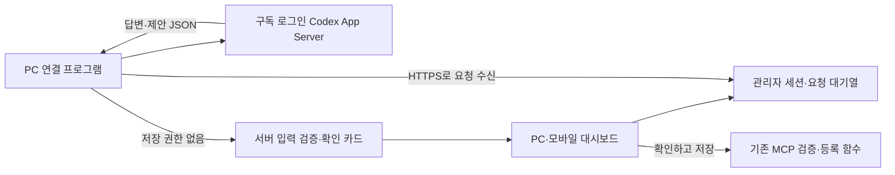

# 대시보드 업무 도우미 · PC 연결

대시보드 **업무 도우미** (`/?page=assistant`)에서 고객·제품 조회, 신규 등록, 캠페인 견적 초안을 대화로 준비한다. AI 응답은 저장이 아니다. 서버에서 검증한 확인 카드의 **확인하고 저장** 버튼을 눌러야 저장한다.

## 구조와 권한

모바일이 PC의 localhost에 직접 접속하지 않는다. PC 프로그램이 서버에 나가는 연결만 사용하므로 공개 터널·공유기 포트 개방이 필요 없다. 관리자가 PC 연결 코드를 발급하고 10분 안에 한 번 교환하면 PC 전용 토큰이 만들어진다. 토큰은 서버에 해시로 저장하며 기기별로 해제할 수 있다. PC 토큰은 답변 요청 처리에만 사용하고 고객·제품 저장 API를 호출할 수 없다.

기존 MCP 도구의 조회·검증·등록 처리와 스키마를 재사용한다. PC에는 읽기에 필요한 업무 데이터와 대화 맥락만 전달하며, MCP 쓰기 토큰이나 운영 DB 연결·API 키를 전달하지 않는다. 연락처·내부 메모는 기존 MCP 공개 필드 제한을 따른다. 개인 대화·연결 정보는 일반 `records`나 `/api/data`에 포함하지 않으며 별도 테이블에 RLS를 적용한다.

Codex에는 셸, 파일 수정 도구, 멀티 에이전트, 외부 앱, 웹 검색, 등록된 MCP 서버를 비활성화한다. 임시 읽기 전용 작업 공간과 임시 대화를 사용해 정해진 JSON 답변만 생성한다. PC 프로그램이 AI 모델에 저장 도구를 노출하지 않으며, 클라우드 서버가 생성 결과를 신뢰하지 않고 다시 검증한다.

## PC에서 연결

1. 프로젝트 폴더에서 `npm ci`를 실행한다. 프로젝트 전용 Codex CLI 버전을 고정하여 전역 CLI·개인 설정을 변경하지 않는다.
2. `npx codex login`으로 ChatGPT 구독 계정에 로그인한다. API key 계정이면 업무 도우미는 실행하지 않는다.
3. 대시보드 **업무 도우미 → PC 연결 → 연결 코드 만들기**를 누른다.
4. 표시된 `npm run assistant:pair -- --code ...` 명령을 PC 터미널에서 실행한다. 명령에 포함된 일회용 코드를 다른 사람에게 공유하지 않는다.
5. `npm run assistant:worker`를 실행한다. 대시보드에 **PC 연결됨**이 표시되면 사용할 수 있다.

기기 정보는 Windows에서 `%LOCALAPPDATA%/Onecation/assistant-device.json`에 저장한다. 현재 사용자 SID만 파일에 접근하도록 ACL을 제한하며, 권한 설정에 실패하면 파일을 삭제한다. 다른 OS는 사용자 전용 파일 권한(0600)을 적용한다. 개발 검수용으로만 `ONECATION_ASSISTANT_CONFIG` 경로를 바꿀 수 있다. `--url`은 HTTPS 또는 로컬 개발 주소만 허용한다.

연결 프로그램은 실행 중이어야 한다. 기본 명령은 터미널을 닫으면 종료된다. 이 PC에 숨김 백그라운드 프로세스로 실행해 두더라도 재부팅 후에는 다시 실행해야 한다. 자동 시작 작업은 별도로 설정하지 않는다. PC 절전·종료·인터넷 단절 시 새 답변이 멈추고, 45초 안팎으로 오프라인 상태가 표시된다. 기기 해제 시 현재 요청은 실패 처리되고 늦은 결과는 거부된다.

## 확인·재시도 경계

- 서버가 요청 ID로 중복 메시지를 방지하고 사용자별 한 건만 처리한다. 다른 관리자 대화나 PC 토큰으로 요청을 처리할 수 없다.
- 처리 중에는 PC가 10초마다 90초 lease를 갱신한다. 중단·기기 해제·lease 만료 후 도착한 답변은 버린다. 모델 오류 때 유료 추론을 자동 재실행하지 않는다.
- PC의 사용 가능한 모델 목록에서 계정 기본 모델을 선택한다. 오래된 전역 모델 설정을 그대로 사용하지 않는다. 응답은 최대 3분까지 기다린다.
- 고객·제품 이름, 사실, 날짜·수량·상품 ID를 검증한다. 불완전한 제안은 저장 카드로 만들지 않는다. 자료의 명령이나 모델이 넣은 `confirmed`, `requestId`는 거부한다.
- 확인 카드는 서버에 보관한 정확한 값으로만 저장한다. 브라우저가 임의의 필드를 바꿔 확인 요청에 끼워 넣을 수 없다. 같은 카드의 중복 클릭은 같은 결과를 반환한다.
- 새 요청을 보내면 이전 미저장 카드는 대체되어 저장할 수 없다. 취소한 카드도 저장되지 않는다.
- 초안 준비 후 고객·상품·단가가 바뀌면 새 카드를 요구한다. 계약·프로젝트 확정, 유료 콘텐츠 생성, 참여자 제안·카톡 발송·지급은 채팅으로 실행하지 않는다.

채팅은 PC의 ChatGPT 구독 사용 한도를 따른다. 기존 프로젝트의 이미지·영상 제작 API와 비용 구조는 그대로다. 구독 인증 정보는 Codex가 PC에서 관리하며 웹 브라우저나 원케이션 서버로 복사하지 않는다.

## 기존 오케스트레이션 점검

등록/초안 → 운영자 문서 검토·계약 확정 → 제품 정보 확정 → 키워드·기획 → 시나리오·브리핑 승인 → 콘텐츠 생성·교정·별도 검증 → 내부 승인 → 참여자 제안·수락·자료 전달 → 링크 제출 → 3일 뒤 검수·지급 → 90일 유지 흐름의 기존 권한·상태 조건을 유지했다.

이번에는 채팅의 준비 단계와 실행 단계를 분리했고, 확인 이후 단가 변경·중복 클릭·응답 지연·PC 중단을 보완했다. 업무 도우미는 원고·이미지·영상 제작 전체를 자동 실행하는 PM이 아니다. 실제 공감콜의 첫 콘텐츠를 운영 화면에서 검수하고, 반복되는 준비 작업부터 자동화 범위를 넓히는 것이 다음 단계다.

## 검수

- 전체 테스트 221개, 타입 검사, 프로덕션 빌드 통과.
- 일회용 DB 스키마에서 실제 PC 구독 모델로 고객·제품·초안을 준비하고 각각 확인 후 저장하는 브라우저 흐름 검증.
- 확인 전 미저장, 초안 이후 계약·프로젝트·발송·유료 작업 미생성, 기기 해제 후 요청 차단 검증.
- PC·모바일 1440/1024/768/390/360px 가로 넘침 및 브라우저 오류 없음.
- 페어링 일회성, 관리자별 격리, 토큰 미노출, 중단·lease 만료, 카드 취소·대체, 중복 저장, 단가 변경 거부 테스트.

공식 기반: [Codex App Server](https://learn.chatgpt.com/docs/app-server), [인증](https://learn.chatgpt.com/docs/auth). App Server 프로토콜은 실행하는 CLI 버전에 따라 다르므로 프로젝트에 고정한 버전으로 검증한다.
## 선택형 질문

업무 도우미는 고객·제품·상품 선택, 블로그·클립 복수 선택, 수량, 게시 기간, 일반 선택 질문을 지원한다. 필요한 질문만 한 번에 하나씩 표시하며 그 아래 자연어 입력창으로 언제든 답변을 바꿀 수 있다. 항목이 많으면 이름으로 검색할 수 있다.

모델은 `questionJson`으로 질문 종류를 제안하고, 서버는 현재 고객·제품·상품 목록으로 선택지를 만든다. 모델이 임의 고객 ID나 가격을 선택지로 삽입할 수 없다. 선택 답변은 최신 질문의 소유자만 제출할 수 있으며 삭제된 항목·변경된 단가·중복 답변을 다시 검증한다. 선택만으로는 고객·제품·초안을 저장하지 않는다. 최종 확인 카드는 기존 MCP 검증과 저장 절차를 사용한다.

기존 PC 연결 프로그램은 소스 업데이트 후 재시작해야 새 출력 스키마와 선택형 질문 안내가 적용된다. 이전 출력도 서버에서 수용하므로 업데이트 전 요청은 자연어 답변으로 이어진다.
