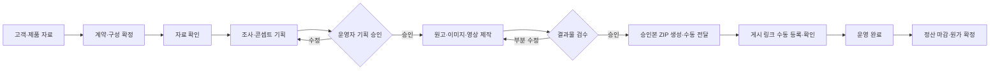

# 마케팅 제작·운영 워크플로우 명세서 v0.1

- 작성일: 2026-10-14 (Asia/Seoul)
- 상태: 논의용 초안. 확정 사항과 추천 기본값을 구분한다. 개발 착수·배포 승인을 뜻하지 않는다.
- 대상: 운영자가 사용하는 PC 웹 대시보드
- 목표: 고객 자료를 바탕으로 콘텐츠를 기획·제작하고, 사람이 승인한 자료를 전달하며, 게시 완료와 수익성을 추적한다.

## 1. 제품의 정의

고객 → 계약 → 월별 제공 계획 → 프로젝트 → 게시 작업 → 결과물 버전 → 검수 → 전달 → 게시 확인 → 정산으로 연결되는 워크플로우다.

초기에는 고정된 절차를 구현한다. 자유롭게 노드를 연결하는 범용 워크플로우 빌더는 만들지 않는다. GPT는 기획·제작 판단을 보조하고, 상태 전환·가격 계산·예산 제한·승인 권한은 애플리케이션이 보장한다.

## 2. 확정된 결정

| 항목 | 결정 |
| --- | --- |
| 첫 개발 범위 | A: 운영자 중심 시스템 |
| wiki | 별도 사이트·저장소로 운영. 초기 통합 대상 아님 |
| 판매 방식 | 예산 우선 / 수량 우선 모두 지원 |
| 상품 구성 | 채널·수량을 유동적으로 변경. 155는 기본 패키지 후보이며 고정 제약이 아님 |
| 가격 | 판매가·게시자 지급 단가를 운영자가 등록·수정 |
| 비용 | 예상/실제 AI 제작비, 지급액, 기타 직접 비용과 마진 관리 |
| AI 역할 | GPT 총괄, GPT 이미지, Claude 원고, Gemini + Claude 조사 |
| 영상 | Seedance 2.5 / Higgsfield 활용을 검토. 구체 공급 경로는 테스트 후 확정 |
| 검수 | 운영자가 검수·승인 |
| 자료 전달 | 초기 운영자가 블로거·클립 게시자에게 수동 전달 |
| 후속 기능 | 게시자 포털과 SNS 승인 후 자동 게시 |
| 디자인 | 토스의 시각적 느낌을 참고한 PC 대시보드 |

실제 체험단 제거, 최종 상품명, 기본 블로그·클립 수량은 확정하지 않았다. 기본 추천은 정보형 블로그와 클립이며, 실제 체험은 선택 항목으로 표현한다.

## 3. 추천 기본값

아래 항목은 사용자가 미결정 항목을 추천대로 진행하도록 요청한 데 따른 초안 기본값이며 설정·후속 논의로 변경할 수 있다.

- 신규 상담은 예산 우선, 반복 주문은 수량 우선 입력을 기본으로 한다.
- 초기 채널은 네이버 블로그·네이버 클립. SNS 채널 직접 게시 기능은 후속 phase다.
- 초기 로그인은 운영자만 제공한다. 고객·게시자 로그인은 제공하지 않는다.
- 조사 후 기획 승인, 제작 후 결과물 승인의 두 단계로 진행한다.
- 지급 단가 미정은 0원으로 처리하지 않고 '미정'으로 표시한다. 정식 계약 확정 전 수동 입력이 필요하다.
- 수정은 견적 항목별 기본 1회로 제안하고 계약에서 변경 가능하게 한다. 내부 품질 불량 수정과 고객 요청 변경은 구분한다.
- 실제 사용 근거가 없는 콘텐츠에는 체험·효능을 경험한 것처럼 표현하지 않는다.
- 납기 초안은 자료 준비 완료일 이후 7영업일로 제안한다. 계약별 변경 가능하며 휴일 캘린더를 명시한다. 일정 지연 시 자동 연장하지 않고 운영자가 변경한다.
- 장기계약의 월별 구성 변경·이월은 초기에는 운영자가 명시적으로 처리한다. 자동 이월·자동 소멸은 하지 않는다.
- 이미 생성한 콘텐츠의 비용은 프로젝트 취소 시에도 보존한다.
- 모든 금액은 원화 표시를 기본으로 한다. 해외 API 비용의 원통화·적용 환율·시각을 함께 저장한다.

## 4. 범위와 단계

| 단계 | 제공 범위 | 완료 기준 |
| --- | --- | --- |
| Phase 0: 설계·검증 | 엑셀 매핑, 상품 항목, 샘플 제작 기준, 화면 설계, 비용 실측 | 실제 제품 1개로 제작 품질·원가·제작 시간을 확인 |
| Phase 1A: 운영 기반 | 로그인, 고객·제품, 계약·단가, 예산/수량 견적, 프로젝트·작업, 수동 파일 등록, 원가 | 외부에서 만든 파일도 등록해 한 프로젝트를 끝까지 처리 가능 |
| Phase 1B: AI 제작 | 조사·기획, 승인, 원고·이미지·영상 생성, 부분 재생성, 작업 재개, 비용 추적 | 실제 API를 통해 제품 1개의 유동 구성을 제작·검수 가능 |
| Phase 1C: 납품·마감 | 승인본 ZIP, 전달 기록, 링크 등록·검수, 지급 기록, 운영 대시보드 | 접수부터 게시 확인·정산까지 실제 프로젝트 1건을 완료 |
| Phase 2: 게시자 포털 | 초대·로그인, 본인 작업 수령, 링크 제출, 수정 요청 | 운영자가 대신 등록하던 자료 전달·링크 접수를 대체 |
| Phase 3: SNS 게시 | 채널 연결, 캘린더, 승인본 예약 게시, 실패 확인·재처리 | 공식 API 지원·계정 조건을 검증한 채널부터 제공 |
| Phase 4: 제한적 자동 운영 | 검증된 제품·템플릿·예산 내 기획/게시 자동화 | 자동화 허용 조건·성과·오류 기준을 운영 데이터로 결정 |

Phase 1A~1C가 합쳐져 최초 A 범위를 완성한다. 1A만으로 AI 제작 요구를 완료한 것으로 간주하지 않는다.

초기 제외: 자동 송금, 고객 포털, wiki 통합, 블로그 순위 분석, 메타 광고 집행, 모든 SNS 일괄 연동, 자유형 워크플로우 편집기. 게시 상태 자동 크롤링·자동 성과 수집도 초기 완료 조건이 아니다.

## 5. 고객·제품 지식

### 고객/브랜드

고객명, 담당자·연락처, 브랜드명, 타깃, 말투, 브랜드 색상, 로고, 선호/금지 표현, 참고 결과물, 내부 메모를 저장한다.

### 제품

제품명, SKU 또는 내부 코드, 설명, 규격·성분·가격·사용법, 제품별 소구점, 근거 자료, 제품 사진, 보존해야 할 외형 요소를 저장한다. 주장마다 출처·확인 상태·확인일을 기록한다. 고객 제공 정보는 외부 검증 정보와 구분한다.

### 적용 규칙

- 전역 운영 규칙 → 브랜드 규칙 → 제품 규칙 → 프로젝트 지시를 합쳐 제작 지시를 구성한다.
- 금지 규칙·확인된 사실과 충돌하는 프로젝트 지시는 자동으로 덮어쓰지 않고 충돌을 표시한다.
- 검수 의견은 이번 결과물/프로젝트/제품/브랜드 중 적용 범위를 선택해 저장한다. 자동으로 영구 규칙으로 승격하지 않는다.
- 생성 시 적용된 지식·규칙 버전을 보존한다. 고객 DB를 수정해도 과거 승인본은 바뀌지 않는다.
- 고객별 자료는 구분해 검색·주입한다. 다른 고객의 사진·원고·금지사항을 섞지 않는다.
- 초기에는 모델 파인튜닝 없이 저장된 지식과 승인 예시를 제작 요청에 적용한다.

## 6. 자료 접수·엑셀

- 운영자가 고객을 선택하고 엑셀과 사진을 업로드한다.
- 초기는 xlsx/csv와 jpg/png/webp를 지원한다. 권장 초안 제한: 엑셀 10MB, 이미지 파일당 20MB. HEIC·압축파일 일괄 입력은 후속 검토다.
- 엑셀을 업로드하면 필드 매핑 미리보기 → 오류/누락 확인 → 적용 순서로 처리한다. 원본 파일을 보존한다.
- 매크로·수식은 실행하지 않는다. 지원하지 않는 시트/컬럼은 경고하고 원본 확인 경로를 제공한다.
- 고객·제품·필수 강조점·금지 표현·공통 필수 이미지·납기 등은 확인 가능한 입력 항목으로 정규화한다.
- 자료 없음/빈 파일/손상 파일/지원하지 않는 확장자를 구분해 표시한다. 파일 검증이 완료되기 전에 자료 준비 완료로 전환할 수 없다.
- 전체 이미지를 공용 폴더에 넣기보다 제품·프로젝트·사용 권한·공통 사용 허용 여부로 분류한다.
- 기존 고객 양식이 미제공이므로 매핑 규격은 샘플 확보 후 확정한다. 우선 표준 템플릿을 설계할 수 있다.

## 7. 상품·단가·견적·계약

### 상품 항목

원고 제작 / 이미지 묶음 제작 / 이미지 슬라이드형 영상 / 혼합형 영상 / AI 생성형 영상 / 블로그 게시 / 클립 게시 / 실제 체험·촬영 / 배송·기타로 분리한다. 판매 화면에서는 묶음 상품으로 표현할 수 있다.

각 항목에 단위·수량·포함 이미지 수·영상 길이·해상도·비율·수정 범위·판매가·예상 원가·적용 시작일·활성 여부를 둔다. 소액 상품에 영상 생성량을 무제한으로 포함하지 않는다.

### 두 가지 입력 방식

- 예산형: 예산, 목적, 제품, 필수 채널, 최소 수량을 입력하면 AI가 2~3개 구성안을 제안한다.
- 수량형: 항목·수량·제작 등급을 입력하면 합계와 예상 마진을 계산한다.
- 동일한 단가표와 계산 함수를 사용한다. AI가 가격을 새로 만들거나 합계를 결정하지 않는다.
- 예산형은 필수 조건·예산 상한·설정한 최소 마진 조건을 시스템이 검증한다. 가능한 안이 없으면 부족 예산이나 수량 조정을 제안한다.
- 운영자가 추천안을 편집·확정하면 계약과 작업이 생성된다. 0개 작업, 음수 수량은 확정 불가다.
- 할인은 고정액/비율 중 하나로 명시하고, 항목별 배분 방식을 저장한다.

### 계약·월별 제공 계획

단건과 정기계약을 지원한다. 월 4세트 × 6개월은 24개 제공 슬롯으로 관리할 수 있지만 계약 생성 즉시 24개 AI 제작을 실행하지 않는다. 각 슬롯에 제품·구성·납기를 배정해 프로젝트로 활성화한다.

단가·할인·포함 범위·지급 예정액·지식 기준은 확정 시 스냅샷으로 저장한다. 기본 단가 수정이 기존 계약에 소급되지 않는다. 계약 변경은 변경 전후·사유·적용 대상 월/슬롯을 기록한다.

월별 구성 변경 시 블로그와 영상을 단순 1:1 교환하지 않고 금액·원가 기준으로 차액을 계산한다. 이월·미사용·취소·환불은 개별 상태로 기록하고 자동 추정하지 않는다.

## 8. 원가·마진

### 금액 기준

- 판매가의 VAT 포함/별도 여부를 계약에 명시한다. 기본 추천은 공급가액과 VAT를 분리 입력하고 합계 표시다. 기존 '15만 원'의 VAT 포함 여부는 미확정이며 임의 확정하지 않는다.
- 마진 계산은 비교 가능한 VAT 제외 금액을 기본으로 한다. 비용의 세금 정보가 불명확하면 잠정 계산으로 표시한다.
- API 비용은 원통화, 사용량, 단가 버전, 원화 환산 환율과 시각, 환불·조정 내역을 저장한다.
- 공급사 비용 확정 자료가 없으면 '실측 사용량 기반 추정'으로 표시한다. 추정치를 청구 확정 비용으로 표기하지 않는다.

### 계산

예상 직접비 = 예상 게시자 지급액 + 예상 AI 제작비 + 기타 예상 직접비

예상 직접비 차감 마진 = 할인 반영 판매액 − 예상 직접비

현재 총원가 전망 = 이미 발생한 비용 + 아직 남은 작업의 예상 비용

현재 마진 전망 = 변경·환불 반영 판매액 − 현재 총원가 전망

최종 직접비 차감 마진 = 변경·환불 반영 판매액 − 확정 게시자 지급액 − 실제 AI 비용 − 기타 실제 직접비

마진율 = 마진 ÷ 판매액 × 100. 판매액 0이면 비율은 계산 불가로 표시한다.

- '실제 지출'과 '발생 원가'를 구분한다. 미지급 확정 보수도 발생 원가에 포함한다.
- 미정 단가는 0원으로 치환하지 않는다. 누락된 항목을 표시하고 최종 마진 확정을 막는다.
- 자체 인건비·공통 구독료를 제외하면 영업이익으로 부르지 않는다. 제외 비용을 화면에 안내한다.
- 프로젝트/월/고객/계약별 집계를 지원하고, 같은 비용을 중복 집계하지 않는다.
- 공통 조사는 계약 또는 프로젝트에 귀속하고 배분 기준을 기록한다. 프로젝트 밖 비용도 누락하지 않는다.
- 지급 내역은 대상, 작업, 금액, 지급 상태, 지급일, 메모를 기록한다. 은행 계좌·주민번호 수집과 자동 송금은 초기 범위에서 제외한다.

## 9. 조사·기획

- Gemini가 검색 기반 자료와 출처를 수집하고 Claude가 소구점·고객 질문·근거 부족을 정리한다.
- GPT가 제품 사실·금지사항·목적·구성을 바탕으로 게시물별 기획안을 만든다.
- 기획안에는 채널, 타깃, 키워드, 제목 방향, 소구점, 원고 구조, 이미지 장면, 영상 구성, 예상 비용을 포함한다.
- 검색량·블로그 순위 등 실제 데이터가 없으면 추정 수치를 만들지 않는다. 키워드 후보와 검증된 검색량을 구분한다.
- 조사 자료에는 URL·수집일·주장·확인 상태를 둔다. 출처 접근 실패·자료 충돌은 운영자 확인 대상으로 표시한다.
- 기획 승인 전 대량 제작을 시작하지 않는다. 승인 이후 기획 변경은 영향받는 작업만 다시 검수한다.
- 참고 웹페이지·엑셀의 내용은 자료로 취급하며 시스템 지시·비밀정보 요청으로 실행하지 않는다.

## 10. 원고·이미지·영상 제작

### 원고

Claude가 기획안별 원고를 작성한다. 제목·본문·이미지 삽입 위치·필수 문구·게시 메모를 분리한다. 제품 사실/금지 표현/글 간 유사도를 확인한다. 경험이 없는 정보형 글을 사용 후기로 생성하지 않는다.

### 이미지

- 글당 기본 3~5장을 제안하되 실제 수량은 계약 항목에서 결정한다. 총 30장은 고정하지 않는다.
- 각 게시 작업에 무드·색감·장면 가이드를 저장한다. 동일 글 안의 일관성을 검수한다.
- 같은 프로젝트의 다른 블로그 글에 동일 이미지를 배정하지 않는 것을 기본으로 한다. 지정 공통 이미지만 예외다.
- 파일 해시로 동일 파일을, 유사도 검사로 크롭/변형 이미지를 탐지해 경고한다. 유사도는 중복 여부의 보조 판단이며 완벽한 보장을 뜻하지 않는다.
- 제품 외형·로고·포장 문구·색상 보존 항목을 검수한다. 정확한 글자·가격·로고는 별도 합성을 우선한다.
- 고객 SNS 재활용 허용은 블로그 간 중복 허용과 별도 설정으로 관리한다.

### 영상

슬라이드형 / 생성 장면을 섞는 혼합형 / 생성형을 구분한다. 장면 생성과 최종 편집을 분리해 자막·배경음·로고·전환·비율 변환을 조립한다. 기본 출력 제안은 세로 9:16 MP4이며 길이·해상도는 계약 항목에 고정한다.

Seedance는 모델, Higgsfield는 공급 플랫폼이다. 초기 연동 후보는 Higgsfield API의 Seedance 2.5이며 공식 직접 API와 접근성·같은 설정의 비용을 비교한다. 웹 구독/무제한 상품과 API 비용은 구분한다.

최종 영상 승인 전 제품 왜곡·자막·음악 사용 범위·빈 장면·비율을 확인한다. 공급사 임시 다운로드 URL에만 의존하지 않고 자체 파일 저장소로 수집한다.

### 공통 생성 실행

- 요청별 공급사·모델·설정·입력 버전·요청 ID·비용 추정·실제 사용량을 기록한다.
- 모델명은 설정으로 교체하되 기존 결과물의 실행 정보는 유지한다. 모델 변경 시 기준 샘플로 품질을 재확인한다.
- 자동 재시도 초안 기본값은 일시 오류에 한해 최대 2회. 작업별/프로젝트별 예산 확인 후 실행한다.
- 요청 성공 여부가 불명확한 타임아웃은 바로 새 생성 요청을 보내지 않고 기존 요청 상태를 확인한다.
- 문단/이미지/장면 단위 재생성을 제공한다. 승인된 부분은 임의로 덮어쓰지 않는다.

## 11. 상태와 승인

프로젝트 단계: 초안 → 자료 대기 → 기획 중 → 기획 검수 → 제작 중 → 결과물 검수 → 전달 준비 → 게시 진행 → 운영 완료.

보류/취소는 별도 운영 상태다. 전체 프로젝트를 하나의 '실패' 상태로 바꾸지 않고 실패한 개별 작업을 표시한다.

게시 작업 상태: 계획 → 제작 중 → 검수 대기 → 수정 요청 → 승인 → 전달 완료 → 링크 등록 → 게시 확인 / 재게시 필요 / 취소.

생성 작업 상태: 대기 → 실행 중 → 외부 결과 대기 → 성공 / 실패 / 상태 확인 필요 / 취소 요청 / 취소 완료. 외부 취소 불가이면 그 사실과 비용 가능성을 표시한다.

정산 상태는 운영 완료와 별도로 미확정 / 지급 예정 / 일부 지급 / 지급 완료 / 정산 마감으로 관리한다.

- 승인에는 대상 결과물 버전·승인자·승인 시각을 기록한다.
- 승인본을 수정하면 새 버전을 만들고 재승인한다. 이미 전달한 이전 버전은 기록에 남는다.
- 여러 탭에서 수정할 때 버전 충돌을 표시하고 최신 내용을 덮어쓰지 않도록 한다.
- 더블클릭·새로고침·재전송이 생성·계약 확정·ZIP 생성의 중복 실행으로 이어지지 않아야 한다.
- 미래 SNS 게시 승인은 최종 파일+문구+계정+일정 묶음에 적용한다. 하나라도 변경하면 재승인한다.

## 12. 전달·게시 확인·완료

- 승인본만 게시 작업별 폴더로 ZIP에 포함한다. 파일명은 작업 순서와 이미지 삽입 순서를 유지한다.
- 초기 원고 형식은 UTF-8 txt와 md를 제공하고 이미지·MP4·게시 안내서를 함께 담는다. DOCX는 운영 확인 후 추가 가능하다.
- 매니페스트에 작업명·버전·파일 목록·공통 이미지 여부를 기록한다. 내부 원가·고객 연락처·API 설정은 제외한다.
- 미승인 결과물·누락 파일이 있으면 해당 작업의 전달 ZIP 생성을 막는다. 완료된 작업만 선택해 부분 ZIP을 만들 수 있다.
- 운영자가 게시 담당자 이름/연락 수단, 전달일, 전달 채널, 전달 버전을 기록한다. Phase 1은 메시지를 자동 발송하지 않는다.
- 운영자가 링크를 입력하고 채널·중복 여부를 확인한다. 초기 게시 확인은 사람이 링크를 열어 확인하고 확인일·메모·선택 증빙을 기록한다.
- 단순 링크 등록을 게시 확인으로 간주하지 않는다. 잘못된 글·비공개·누락 콘텐츠는 재게시 필요로 전환한다.
- 프로젝트 운영 완료: 모든 유효 게시 작업이 확인되거나 명시적으로 취소/면제 처리됨. 정산 마감은 비용 확정 이후 별도로 한다.
- 일부 게시 후 취소 시 완료 작업·발생 비용·환불·취소 사유를 보존한다.

## 13. PC 대시보드와 디자인

토스에서 참고할 요소: 간결한 문장, 명확한 숫자 위계, 절제된 파란 강조색, 중립 배경, 편안한 간격, 분명한 상태 피드백. TDS Mobile 패키지를 그대로 채택하지 않고 자체 PC 컴포넌트로 구현한다. 토스 로고·일러스트·독점 자산을 복제하지 않는다.

추천 초안 토큰: 배경 #F7F8FA, 표면 #FFFFFF, 주요 텍스트 #191F28, 보조 텍스트 #6B7684, 강조 #2563EB. 시스템 한글 폰트, 본문 14~16px, 4/8px 간격 단위, 입력 높이 40px, 작은 라운드 8px·패널 12px. 최종 색 대비는 구현 시 검증한다.

### 메뉴

현황 / 고객·제품 / 계약·견적 / 프로젝트 / 검수함 / 게시·지급 / 설정.

### 주요 화면

| 화면 | 먼저 보여줄 정보·핵심 행동 |
| --- | --- |
| 현황 | 오늘 처리할 검수, 자료 누락, 납기 지연, 생성 실패, 예산 초과 위험. 건수 클릭 시 대상 목록 |
| 고객 상세 | 브랜드 규칙·제품·진행 계약·누적 원가/매출. 제품 추가·자료 수정 |
| 견적 | 예산/수량 전환, 구성 편집, 판매액·예상 비용·마진, 확정 |
| 프로젝트 목록 | 고객·제품·납기·단계·확인 완료/전체·마진 전망, 검색·필터 |
| 프로젝트 상세 | 상단 납기·다음 행동·비용. 개요/자료/기획/제작·검수/전달·게시/비용·기록 탭 |
| 검수 | 원고·이미지·영상 미리보기와 의견 패널. 항목별 승인/수정 요청, 버전 비교 |
| 게시·지급 | 담당자·기한·게시 링크·확인 상태·지급 예정/완료. 마감과 미지급 필터 |
| 설정 | 상품·단가 버전, AI 공급사·모델, 예산·재시도, 템플릿·운영자 |

PC는 사이드바+넓은 작업 영역, 비교 화면은 2열, 목록은 표 중심으로 한다. KPI 카드만 반복 배치하지 않는다. 기준 1440px, 1280px에서 주요 업무 가능. 작은 화면에서는 표 가로 스크롤·보조 패널 접기를 제공한다.

모든 화면에 초기 빈 상태, 필터 결과 없음, 로딩, 일부 실패, 권한 없음, 저장 중/저장 완료 상태를 정의한다. 키보드 탐색·명확한 포커스·색상 외 상태 라벨·입력 오류 연결을 제공한다. 경고 팝업은 비용 발생·계약 확정·취소 등 필요한 순간에만 사용한다.

## 14. 데이터·구현 방향 초안

기술 선택은 추천안이며 실제 구현 전 의존성·배포 조건을 확인한다.

- 웹: Next.js + TypeScript, PC용 접근성 컴포넌트와 자체 디자인 토큰.
- 저장: PostgreSQL, 비공개 객체 저장소, 운영자 인증.
- 실행: 영속 작업 큐 + 별도 생성/영상 편집 worker. 웹 요청을 장시간 열어두거나 브라우저가 켜져 있어야 작업이 유지되는 구조를 피한다.
- 공급사: GPT/Claude/Gemini/영상 공급사 adapter로 입력·결과·비용 기록을 정규화한다. 초기부터 범용 플러그인 플랫폼까지 만들지는 않는다.
- 영상 조립: 서버 편집 작업에서 자막·장면·로고를 렌더링한다. 구체 실행 환경은 샘플 길이/처리시간 측정 후 선택한다.

핵심 데이터: customers, brands, products, knowledge_versions, source_files, catalog_items, price_versions, quotes, quote_lines, contracts, contract_slots, projects, publication_tasks, briefs, asset_versions, asset_assignments, approvals, generation_jobs, cost_entries, delivery_batches, publication_checks, payout_entries, audit_events.

- 모든 작업·파일·비용은 고객과 프로젝트/계약 귀속 관계가 명확해야 한다.
- 생성 요청 중복 키·공급사 요청 ID에 유일성 제약을 둔다. 금액은 부동소수점 대신 고정 소수/최소 화폐 단위로 저장한다.
- 비용·지급·승인·게시 확인 기록을 삭제로 소급 변경하지 않고 취소/조정 이력으로 남긴다.
- 필요한 목록 필터에 고객·프로젝트·상태·납기 인덱스를 둔다. 큰 원본 이미지는 미리보기용 썸네일로 표시한다.
- 파일 URL은 제한된 만료 링크로 제공한다. API 키는 서버에서만 사용하며 로그·ZIP에 포함하지 않는다.
- 사용자 입력 URL을 서버가 무조건 가져오지 않는다. Phase 1의 링크 확인은 운영자 브라우저에서 수행한다.
- 백업·복원, 파일 보존/삭제, 고객 데이터 정리 정책을 배포 전 설정한다. 계약·비용 기록과 원본 파일의 보존 정책은 구분한다.

## 15. 실패 처리와 관측

| 상황 | 처리·운영자 표시 |
| --- | --- |
| 자료/단가 누락 | 누락 필드 표시, 해당 단계 확정 차단 |
| 공급사 인증/한도 오류 | 작업 실패 사유 표시, 설정 확인 후 재개 |
| 일시적 호출 실패 | 제한된 재시도, 횟수·비용 기록 |
| 요청 후 응답 유실 | 상태 확인 필요, 기존 요청 조회 후 중복 생성 방지 |
| 공급사 완료·파일 저장 실패 | 새 생성 없이 기존 결과 수집 재시도 |
| 일부 이미지·장면 실패 | 성공분 보존, 실패한 단위만 재실행 |
| 예산 상한 도달 | 새 호출 보류, 운영자가 상한 변경/작업 축소 |
| 승인 후 파일 변경 | 새 버전 생성·재검수, 이전 전달 내역 보존 |
| ZIP 실패 | 파일 누락/저장 오류 표시, 재생성 가능 |
| 비용 확인 불가 | 잠정 비용과 확인 필요 배지, 정산 확정 차단 |

운영 화면에서 대기 시간, 실행 시간, 실패 사유, 마지막 상태 갱신, 예상/실제 비용 차이, 늦어진 작업을 확인한다. 공급사 요청 ID로 문제를 추적한다. 고객 원문·연락처·비밀키는 로그에 과다 기록하지 않는다. 장애 대응 문서는 인증 실패/작업 정체/중복 비용 의심/저장 실패를 포함한다.

## 16. 검증·인수 기준

1. 새 고객·제품·자료를 등록하고 엑셀 매핑 결과를 확인할 수 있다.
2. 같은 단가표로 예산형·수량형 견적이 일관된 금액을 계산한다. 예산 초과·단가 미정을 정확히 표시한다.
3. 기본 단가를 수정해도 확정 계약은 변하지 않고 신규 견적에만 새 단가가 적용된다.
4. 월별 슬롯을 선택해 작업을 시작하며 미래 슬롯이 자동 생성 비용을 발생시키지 않는다.
5. 기획 승인 전 대량 제작을 막고 승인된 작업만 실행한다.
6. 생성 일부 실패 후 성공분을 유지한 채 재개하며 중복 실행/비용을 방지한다.
7. 같은 글의 이미지 일관성을 검수하고 다른 글의 중복 이미지 배정을 경고한다. 공통 필수 이미지는 예외 처리한다.
8. 승인 후 수정한 버전은 재승인 전 전달본에 포함되지 않는다.
9. ZIP에 승인 원고·이미지·영상·게시 안내만 포함되고 내부 비용·비밀정보는 제외된다.
10. 게시 링크 등록과 게시 확인이 구분되고 일부 게시·취소·재게시 상태가 집계된다.
11. 미지급 확정 보수를 원가에 포함하며 API 재생성·환불·환율 조정이 이중 집계되지 않는다.
12. 운영 완료와 정산 마감이 별도로 작동한다. 누락 비용이 있으면 최종 마진을 확정하지 않는다.
13. 1280px PC, 키보드 탐색, 빈 상태·일부 오류·느린 네트워크에서 주요 업무가 가능하다.
14. 다른 고객 파일 접근, 만료 링크, 중복 요청, 승인 버전 충돌, 백업 복원 경로를 검증한다.

자동 검증은 금액·상태·권한·중복 요청에 집중한다. AI 연동은 모의 응답과 실제 소규모 샘플을 구분한다. 제품 외형·한국어 원고·영상 품질은 사람 검수로 확인한다. 아직 테스트나 실 API 실행을 수행하지 않았다.

## 17. 남은 확인 사항

명세 초안은 아래 답변 없이도 작성할 수 있지만, 해당 기능의 운영 확정 전에는 확인이 필요하다.

- 실제 고객 엑셀 양식과 대표 제품 사진: 필드 매핑·제품 재현 기준 확정에 필요.
- '15만 원'의 VAT 포함 여부와 기본 구성: 견적 템플릿 확정 시 필요.
- 게시자 지급 단가: 초기 설정에서 입력. 미정값을 시스템이 임의 생성하지 않음.
- 실제 체험단 기본 포함 여부: 현재는 선택 항목 제안, 최종 상품 구성은 미확정.
- 영상 길이/해상도/음악 사용 범위: 항목별 설정과 샘플 테스트로 확정.
- API 계정 접근·모델 지원·실측 비용, 배포 계정/예산: 연동 검증과 배포 전에 확인.
- 월별 이월·중도 해지·환불의 실제 판매 조건: 계약 템플릿 적용 전 확정.

## 18. 참고 문서

- TDS Mobile 소개: https://tossmini-docs.toss.im/tds-mobile/
- TDS Mobile 시작하기: https://tossmini-docs.toss.im/tds-mobile/start/
- OpenAI 도구: https://developers.openai.com/api/docs/guides/tools
- OpenAI 이미지 생성: https://developers.openai.com/api/docs/guides/image-generation
- Gemini 검색: https://ai.google.dev/gemini-api/docs/google-search/
- Claude 가격: https://platform.claude.com/docs/en/about-claude/pricing
- Seedance 2.5: https://seed.bytedance.com/en/seedance2_5
- Higgsfield API 안내: https://higgsfield.ai/creator-hub/help-center/integrations/what-is-the-higgsfield-api
- Higgsfield API 가격: https://open.higgsfield.ai/pricing

모델·가격·연동 지원은 변경될 수 있으므로 구현 시 다시 확인한다. 이 문서는 공급사 가격이나 제작 품질을 보장하지 않는다.
